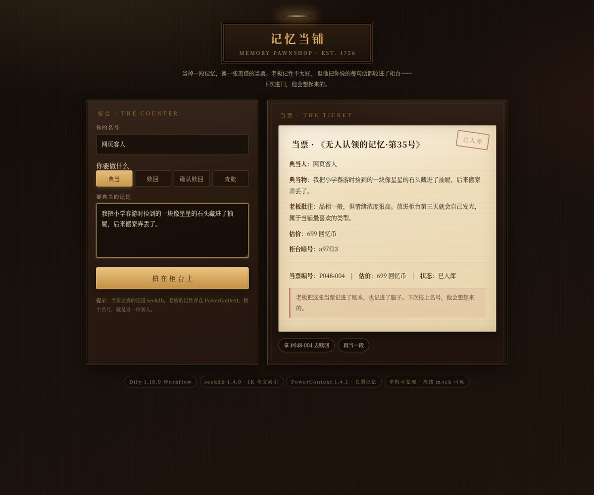

# 记忆当铺 · Memory Pawnshop

> 用 Dify 做一个好玩的智能应用：把一段记忆典当给当铺老板，换一张他现写的、毒舌又温柔的当票。
> 老板会把账记进 **seekdb**，把你的气味记进 **PowerContext**——下次进门，他记得你。



## 1. 这是什么

「记忆当铺」是一家开在时间缝隙里的当铺。玩家可以：

| 动作 | 发生什么 | 技术落点 |
|---|---|---|
| **典当** | 写下一段记忆，老板现写一张当票：标题、批注、离谱估价、柜台暗号 | Dify 提示词 + LLM；网关把当票写进 seekdb，把摘要写进 PowerContext |
| **赎回** | 输入关键词，老板翻账本和长期记忆，念出旧账，提醒利息 | seekdb IK 全文检索 + PowerContext 中文记忆检索，两路结果拼进提示词 |
| **确认赎回** | 报上当票编号，老板把记忆推回你手里，票根盖章 | seekdb 状态机（`pawned → redeemed`），幂等；再赎一次会被老板挖苦 |
| **查账** | 看看自己一共押了多少段人生、值多少回忆币 | seekdb 聚合查询 |

不是「聊天套壳」：**分支、提示词、调用顺序、输出组装都在 Dify Workflow 里**；
seekdb 同时是 **Dify 平台的主数据库**和当铺的业务账本；PowerContext 负责跨会话的玩家长期记忆。
没有模型 Key 也能离线玩（`LLM_MODE=mock`），方便评审复跑。

## 2. 架构

```
┌──────────────┐   HTTP    ┌──────────────────────────────┐
│  体验页 /    │ ────────▶ │ 当铺网关（Python stdlib）      │
│  Dify API    │           │ /api/run  → 转发 Dify 工作流   │
└──────┬───────┘           │ /api/llm  → 模型（OpenAI/mock）│
       │                   │ /api/pawn /redeem /ledger ... │
       │                   └───────┬──────────────┬────────┘
       ▼                           │              │
┌──────────────┐   编排/分支/提示词  │              │ 玩家 scope / 记忆读写
│ Dify 1.18.0  │ ◀─────────────────┘              ▼
│ Workflow     │                          ┌────────────────┐
│  Start       │                          │ PowerContext   │
│  HTTP ×n     │                          │ 1.4.1          │
│  If/Else     │                          └────────────────┘
│  End ×4      │
└──────┬───────┘
       │ Dify 平台数据（应用/工作流/运行记录）
       ▼
┌──────────────────────────────────────────┐
│ seekdb 1.4.0                             │
│  dify 库：172 张平台表                    │
│  pawnshop 库：players / tickets + IK 全文 │
└──────────────────────────────────────────┘
```

**为什么需要网关**：Dify 源码态下没有可用的 code/sandbox 与插件进程；同时每个玩家需要动态创建
PowerContext scope、把当票编号/状态做成真正的事务数据。网关只做「薄适配」——模型创作、分流、
提示词仍由 Dify 完成，这样既跑得起来，又不把 Dify 降级成转发器。

## 3. 技术结合点（可核对）

| 结合 | 具体做法 | 证据 |
|---|---|---|
| seekdb 作为 Dify 主库 | `DB_TYPE=seekdb`、`VECTOR_STORE=seekdb`，`dify` 库 172 张表 | `evidence/seekdb-*.json` 的 `dify_table_count`、`dify_core_tables` |
| seekdb 作为业务账本 | `players` / `tickets`，票号 `Pxxx-yyy`，`status` 状态机 | 同上的 `pawnshop_tables`、`latest_tickets` |
| seekdb 中文检索 | `FULLTEXT ... WITH PARSER ik`，`MATCH ... AGAINST` 召回旧当票 | `ticket_indexes` 的 `ft_ticket`、`fulltext_probe` |
| PowerContext 长期记忆 | 每位玩家一个幂等 scope；典当/赎回写 `decision` 记忆，赎回/查账前检索 | `evidence/powercontext-*.json`、`run_e2e` 的 `powercontext-recall` |
| Dify 真实编排 | 4 个 End 分支、2 段模型提示词、7 个 HTTP 节点、If/Else 路由 | `dsl/memory-pawnshop.yml`、`evidence/dify-app.json` |

## 4. 快速开始

完整步骤见 **[deploy/source-deploy.md](deploy/source-deploy.md)**。最短路径：

```bash
# 1. seekdb 1.4.0（端口 2886）+ Redis（56379）+ Dify 1.18.0 源码（5001）
#    按 deploy/dify.env.example 配 DB_TYPE=seekdb；空库迁移按手册跳过 5578e028b2f2

# 2. 建当铺账本
cd dify
python3 -m venv gateway/.venv
gateway/.venv/bin/pip install -r gateway/requirements.txt
cp gateway/.env.example gateway/.env    # 改 seekdb / PowerContext / 模型配置
gateway/.venv/bin/python scripts/init_db.py

# 3. PowerContext 1.4.1（17429）
powercontext server run --env-file runtime/powercontext/.env

# 4. 网关 + 体验页（8099）
cd gateway && ./run.sh

# 5. 导入并发布 Dify 应用，拿 Service API Key
cd ..
python3 scripts/publish_app.py --email you@example.com --password-file /path/to/pwd \
  --key-out /path/to/dify-app-key.txt
# 把 Key 填进 gateway/.env 的 DIFY_API_KEY，重启网关
```

打开 `http://127.0.0.1:8099/` 即可体验；`/api/health` 会显示 seekdb、PowerContext、
Dify 代理与体验页是否就绪。

## 5. 模型配置

| 模式 | 配置 | 用途 |
|---|---|---|
| `mock` | `LLM_MODE=mock` | 离线复跑；按关键词生成当票文案，票号/估价/状态仍走真实账本 |
| `openai` | `LLM_MODE=openai` + `LLM_BASE_URL` / `LLM_API_KEY` / `LLM_MODEL` | 任意 OpenAI 兼容服务；官方、代理或本地推理均可 |

DSL 里的模型节点统一调用网关 `/api/llm`，所以**换模型不需要改 DSL**，只改网关 `.env`。
mock 模式在文档与体验页均明确标注，不与真实模型结果混淆。

## 6. 验证

```bash
export DIFY_API_KEY=app-xxxx
python3 validation/run_e2e.py --cleanup
```

覆盖：典当 → PowerContext 召回 → 赎回检索 → 确认赎回 → 重复确认（幂等）→ 查账 → 清理。
通过时 8 项全 `PASS`，证据落在 `evidence/e2e-*.json|md`。
场景与预期不变量见 [validation/README.md](validation/README.md)。

辅助验证：

```bash
python3 scripts/verify_powercontext.py              # scope / remember / 中文检索
gateway/.venv/bin/python scripts/verify_seekdb.py   # Dify 172 表 + 当铺表 + IK 索引
```

体验页截图（[evidence/ui](evidence/ui)）：空柜台、当票、赎回回执、账本。

## 7. DSL 说明

- 文件：`dsl/memory-pawnshop.yml`（DSL 0.3.1，导入 Dify 1.18 后自动升到 0.7.0）。
- 导入：控制台「创建应用 → 导入 DSL」，或直接用 `scripts/publish_app.py`（删除同名旧应用、导入、发布、发 Key）。
- 环境变量：`GATEWAY_BASE` 默认 `http://127.0.0.1:8099`。Dify 在容器里时改成可达网关的地址。
- 节点：Start（玩家/动作/内容）→ 召回 → If/Else（典当/赎回/确认赎回/查账）→ HTTP →
  模型 → 入库 → End。所有 HTTP 节点都设置了 `default-value` 降级与 2 次重试；不使用
  Code / Template 节点，因此不依赖 `dify-sandbox`。
- 表单编码：HTTP 节点统一用 `x-www-form-urlencoded`，避免用户任意文本破坏 JSON 结构。

## 8. 目录

```
dify/
├── dsl/memory-pawnshop.yml      # 导入用 DSL
├── gateway/                     # 自定义后端（stdlib + pymysql）
├── web/index.html               # 体验页（网关 / 直接提供）
├── scripts/                     # init_db / publish_app / verify_* / seed_demo / reset_demo
├── validation/                  # run_e2e.py + 场景说明
├── deploy/                      # 源码态部署手册与配置样例
└── evidence/                    # 运行证据与截图
```

## 9. 已知限制

- 验证环境无 Docker daemon，采用源码态部署；手册中的容器提示仅作参考。
- Dify 迁移 `5578e028b2f2` 使用临时表，seekdb 不支持；空库按手册安全跳过（该迁移只清理历史模型数据）。
- IK 词典对网络新词覆盖有限；IK 不可用时账本检索自动退化为 `LIKE`，功能不中断。
- 体验页把 Dify Key 保存在网关进程内；网关、PowerContext、Redis 默认只监听 `127.0.0.1`，Dify API 与 seekdb 可能监听所有网卡，请用防火墙限制访问，不要直接暴露公网。
- 当票文案由模型生成；mock 模式只用于流程验证，不代表真实模型质量。

## 10. 版本

Dify 1.18.0 · seekdb 1.4.0 · PowerContext 1.4.1 · Redis 7.2 · Python 3.13（Dify）/ 3.12+（网关） · pymysql 1.1+
